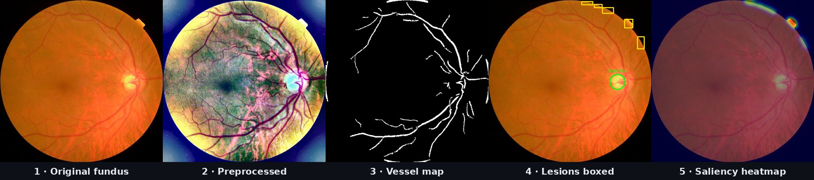

<div align="center">

# 👁️ Netra Setu

### Diabetic retinopathy tele-screening platform for rural India

**Smart India Hackathon 2026 · team project**


</div>

---

## Why this matters

India has over 77 million adults with diabetes, and diabetic retinopathy (DR) is a leading cause of preventable blindness. Early screening prevents most vision loss, but rural India has roughly one ophthalmologist per 100,000 people, so manual screening cannot keep up.

**Netra Setu** ("eye bridge") lets a health worker capture a fundus photo at a primary health centre and get a quality check, a severity grade on the international ICDR 0–4 scale, visual evidence of the lesions behind it, and a PDF report, then routes referable cases to a doctor for review.



---

## What it does

### 1. Image quality gate
Every upload is checked for **focus (blur), illumination and field of view** before grading. Ungradable images are rejected with recapture instructions, so a bad photo never produces a confident wrong answer. → `services/iqa_service.py`

### 2. Preprocessing
Circular crop of the retina, **Ben Graham local-colour normalisation** and **CLAHE** contrast enhancement at 456 × 456. → `services/preprocessor.py`

### 3. Retinal structure and lesion analysis
Vessel segmentation and vessel density, plus detection of the lesions that define DR:

| Lesion | Shown as |
|---|---|
| Microaneurysms and haemorrhages | 🟥 red boxes |
| Hard exudates | 🟨 yellow boxes |
| Cotton-wool spots | ⬜ white boxes |
| Optic disc | 🟢 green circle |

→ `services/biomarker_service.py`

### 4. ICDR severity grading and referral triage
Lesion counts and vessel density map to the five ICDR grades, each with a clinical action:

| Grade | Meaning | Referable | Action |
|---|---|---|---|
| 0 | No DR | No | Routine annual screening |
| 1 | Mild NPDR | No | Review in 6–12 months |
| 2 | Moderate NPDR | **Yes** | Ophthalmologist within 4–6 weeks |
| 3 | Severe NPDR (4-2-1 rule) | **Yes** | Specialist within 1–2 weeks |
| 4 | Proliferative DR | **Yes** | Emergency referral (< 48 h) |

→ `services/model_service.py`

### 5. Explainability and reports
A saliency heatmap highlights the regions that drove the grade, and every screening produces a **downloadable PDF report** with a doctor sign-off box. → `services/gradcam_service.py`, `services/report_service.py`

### 6. Multi-role tele-ophthalmology portal
- **Patient:** upload a scan, see results and history, chat with their doctor or an AI assistant (Gemini)
- **Doctor:** review queue, clinical screening on behalf of patients, sign-off and messaging
- **Admin:** district dashboard, doctor approval and management, patient directory, audit logs

Includes email OTP verification, Google sign-in and JWT-based sessions.

### 7. District telemedicine simulation
A queueing model of the whole screening network (image capture rate, bandwidth, processing throughput and reviewer capacity) to plan resources for programmes serving **100,000+ patients a year**, in Python and as a standalone MATLAB/Simulink script. → `services/simulink_service.py`, `backend/matlab/`

---

## Architecture

```
          Patient / Doctor / Admin web portal (HTML · Tailwind · JS)
                                   │  REST + JWT
                                   ▼
                        Flask API  (backend/app.py)
    ┌──────────────┬──────────────┬───────────────┬──────────────┬──────────────┐
    ▼              ▼              ▼               ▼              ▼              ▼
 Quality gate  Preprocess   Lesion analysis   ICDR grading   Heatmap +     Telemedicine
 (IQA)         (CLAHE,      (vessels, MAs,    + triage       PDF report    simulator
               Ben Graham)  exudates…)
                                   │
                                   ▼
                     MongoDB  (users, screenings, messages)
```

---

## Quick start

**Backend**

```bash
cd backend
python -m venv venv
source venv/bin/activate          # Windows: venv\Scripts\activate
pip install -r requirements.txt
pip install ultralytics torch     # optional: loads the trained YOLO weights
cp .env.example .env              # then fill in MONGO_URI, secrets and admin password
python app.py                     # http://localhost:5001
```

**Frontend:** open `frontend/index.html` in a browser, or serve the `frontend/` folder with any static server. It talks to the backend at `localhost:5001` automatically.

The backend also deploys to Render as is (`render.yaml`); set the environment variables there instead of a `.env` file.

---

## Repository layout

```
backend/
├── app.py                 # Flask API: auth, screening, doctor review, chat, admin, reports
├── config.py              # settings read from environment variables
├── db.py, models.py       # MongoDB access and schemas
├── services/              # iqa, preprocessor, biomarker, model, gradcam, report, simulink, chat
├── matlab/                # standalone Simulink telemedicine model
├── weights/               # trained YOLO model (sih_dr_best_model.pt)
└── data/                  # sample dataset registry (CSV)
frontend/
├── index.html             # landing page and portal
├── patient/  doctor/  admin/
└── assets/images/demo/    # pipeline example images
docs/pipeline.jpg          # figure used in this README
```

---

## Data

Developed with public fundus datasets: **APTOS 2019 Blindness Detection** (5-grade labels) and **IDRiD** (Indian population, lesion-level annotations). Datasets are not included in this repository; download them from their official sources.

---

## Status and roadmap

This is a hackathon prototype, not a medical device.

- **Grading today** comes from the lesion-quantification pipeline mapped to ICDR rules. The trained YOLO weights in `weights/` load at startup; making that model the primary grader is the next step.
- **Heatmap:** currently built from the detected lesion masks; the next step is true gradient-based Grad-CAM from the CNN.
- **Validation:** sensitivity and specificity for referable DR on a held-out APTOS/IDRiD split, followed by clinician review.

---

## Author

**Ojaswi Gondalia** · B.Tech Artificial Intelligence, NMIMS Mumbai  
[GitHub](https://github.com/ojaswi04) · [LinkedIn](https://linkedin.com/in/ojaswi-gondalia-25bb65205) · ojaswigondalia@gmail.com

Built with my team for **Smart India Hackathon 2026**. I led the idea, dataset selection, preprocessing and the screening pipeline.
